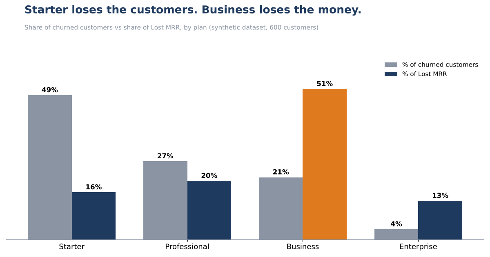
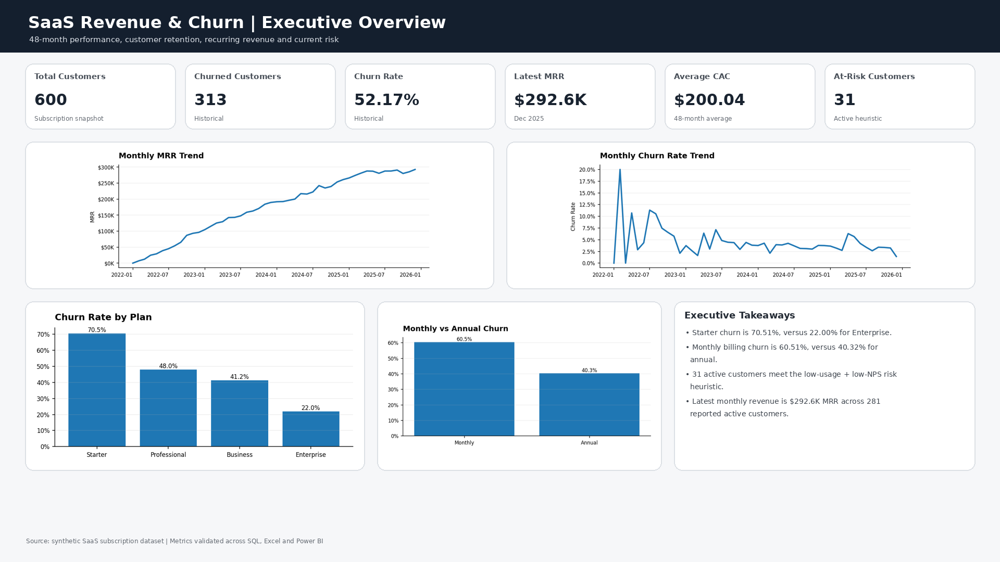
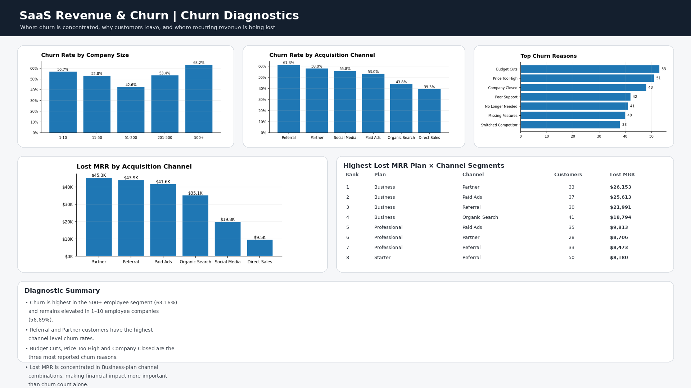
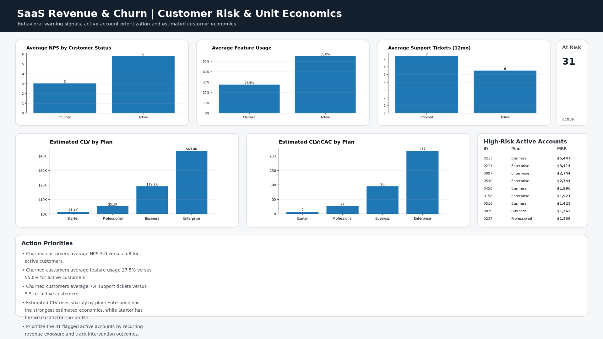

# SaaS Churn: Which Customers Cost the Most, and Who Should We Call First?

> **Synthetic dataset.** 600 subscription customers and 48 months of revenue, built to mirror realistic SaaS behaviour. The project demonstrates the analytical workflow. Dollar figures are illustrative, not a real company.

**Question:** A SaaS company has 52% lifetime churn. Which churn costs the most revenue, and which active accounts should Customer Success contact first?

| | |
|---|---|
| **Answer** | Starter churns most (70.5%) and is 49% of churned customers, but only **16% of Lost MRR**. **Business plans lose 51%** of it ($99.5K of $195.2K), and monthly-billed Business alone is **34.7%**. |
| **Revenue at risk** | **31 active accounts, $28.3K MRR ($340K a year), 9.6% of active MRR.** The top 10 accounts hold 82% of it, and 16 Business and Enterprise accounts hold 88% ($24.8K). |
| **Recommendation** | Call the 16 Business and Enterprise at-risk accounts first. Test monthly-to-annual conversion for Business plans (52.9% churn monthly vs 27.4% annual). Fix Starter onboarding second. |
| **Impact (illustrative scenario)** | Saving 25% to 50% of the at-risk MRR protects **$7.1K to $14.2K MRR, or $85K to $170K a year**. Assumes saved accounts keep today's MRR for 12 months and ignores the cost of outreach. |
| **Tools** | MySQL, Excel, Power BI, DAX, Power Query, Python (revenue-at-risk script) |

---

## 1. Business problem
Churn is the headline number, but it counts a Starter account (average MRR $216) the same as an Enterprise account (average MRR $2,985). Customer Success has limited hours and needs to know where the revenue is.

## 2. Data
`data/subscriptions.csv` (600 customers, one row each) and `data/monthly_revenue.csv` (48 months). Full definitions in [`docs/data_dictionary.md`](docs/data_dictionary.md) and [`docs/methodology.md`](docs/methodology.md).

## 3. Cleaning and validation
Uniqueness, completeness, date and type validity, and categorical integrity checks were run before analysis. Key results were reconciled across SQL, Excel and Power BI:

| KPI | Result |
|---|---|
| Total / churned / active customers | 600 / 313 / 287 |
| Overall churn rate | 52.17% |
| At-risk active customers | 31 |
| December opening MRR (monthly table) / active MRR at end of data | $292,629 / $295,420 |

`python/revenue_at_risk.py` re-derives the control totals and asserts them before it reports anything. A data audit found two inconsistencies (a stray text value in the Excel file and an opening-vs-closing count difference of 281 vs 287). Both are explained and fixed in [`docs/data_reconciliation.md`](docs/data_reconciliation.md).

## 4. Analysis
- **Churn by plan:** Starter 70.5%, Professional 48.0%, Business 41.2%, Enterprise 22.0%.
- **Revenue vs customers:** churned Starter customers average $204 MRR and churned Business customers $1,508, so Business churn costs far more per account.
- **Billing cycle:** Business monthly churn is 52.9% vs 27.4% on annual contracts.
- **Churned customers show lower feature usage and NPS**, which is the basis of the at-risk rule below.

## 5. Key insight
The segment with the worst churn **rate** is not the segment with the worst churn **cost**. Starter is where customers leave. Business is where the money leaves.

## 6. Recommendations
1. **Call the 16 at-risk Business and Enterprise accounts first.** They hold 88% of the at-risk MRR ($24.8K).
2. **Offer annual contracts to monthly Business customers.** Churn is roughly half as high on annual plans, but customers choose their plan, so this is a hypothesis to test, not proof that annual contracts reduce churn.
3. **Improve Starter onboarding and adoption.** It is the volume problem, but the smaller revenue problem.
4. **Review acquisition channels by Lost MRR and retention**, not customer count.

## 7. Business impact (illustrative, synthetic data)
At-risk MRR is $28,319. Saving 25% is $7.1K MRR ($85K a year), and saving 50% is $14.2K MRR ($170K a year).

**At-risk rule:** active, feature usage below 40%, and NPS of 4 or lower. It is a transparent heuristic, not a predictive model, and is intended as an outreach filter.

## Dashboard
Three Power BI pages: Executive Overview, Churn Diagnostics, and Customer Risk and Unit Economics. The images below are preview renderings of the report layout built from the validated data, not raw exports of the .pbix file (see [`screenshots/README.md`](screenshots/README.md)). The .pbix in `powerbi/` is the authoritative version.

## Limitations
- Observational. Segment differences show where churn is concentrated, not why.
- The at-risk flag has not been backtested.
- Estimated CLV is directional (no discounting, margin or expansion). CAC is a blended monthly figure.
- Net revenue retention cannot be computed from the available fields.
- All dollar impact is a scenario on synthetic data.

## Project files
[SQL analysis](sql/saas_churn_revenue_analysis.sql) | [Methodology](docs/methodology.md) | [Data dictionary](docs/data_dictionary.md) | [Data reconciliation](docs/data_reconciliation.md) | `excel/saas_revenue_churn_analysis.xlsx` | `powerbi/saas_churn_dashboard.pbix` | `python/revenue_at_risk.py`
